<!--
SEO metadata: Awesome LLM Application Architectures — the best SaaS platforms and open-source projects for LLM model serving, inference optimization, LLM inference engines (vLLM, SGLang, TensorRT-LLM), and production RAG systems. Includes pricing, free tiers, company size, and GitHub star comparisons.
Keywords: LLM serving, LLM inference engine, model serving platforms, RAG systems, open source LLM, vLLM vs SGLang, LLM deployment, GPU inference, MLOps, AI infrastructure, LLM hosting free tier, LLM pricing comparison 2026
-->

# Awesome-LLM-Application-Architectures

  

## The LLM Application Architectures Ecosystem: Model Serving, Inference Optimization & Production RAG

**The best curated list of SaaS products & open-source GitHub projects for LLM application architectures** — with **pricing**, **free tiers**, **company sizes** and **GitHub stars** compared side by side.  

*Focused on LLM Model Serving, Inference Optimization & Production RAG Systems*  

**Last updated: October 2026**

Looking for the **best LLM inference engine**, a **free LLM hosting tier**, or a **production RAG stack**? This repository tracks notable **SaaS platforms** and **open-source projects** for **LLM application architectures**. These tools provide the serving infrastructure, orchestration layers, and scaling mechanisms needed to deploy production-grade LLM applications—from RAG pipelines and agent systems to high-throughput inference APIs.

**Examples** include Databricks Model Serving, AWS SageMaker, Azure ML, Google Vertex AI, BentoML, Seldon, Triton Inference Server, Ray Serve, KServe, and Modal (the category leaders).

**Open-source emphasis**: This section is heavily expanded with every major active project for self-hosting, Kubernetes-native serving, and transparent inference orchestration—ideal for ML engineers, platform teams, and researchers building vendor-neutral LLM infrastructure.

Contributions welcome! Open a PR to add/update entries. Keep descriptions factual and link to official sites.

## Table of Contents

- [Sector Overview & Market Dynamics](#sector-overview--market-dynamics)

- [SaaS/Hosted Platforms](#saas-hosted-platforms)

- [Open-Source GitHub Projects](#open-source-github-projects)

- [Quick Picks: Best Tools by Use Case](#quick-picks-best-tools-by-use-case)

- [How to Contribute](#how-to-contribute)

- [Disclaimer](#disclaimer)

## Sector Overview & Market Dynamics

**Estimated market size** — The MLOps / model-serving segment covered by this list was valued at **~$3.0B in 2025** and is forecast to grow to **~$16.6B by 2030 (40.5% CAGR)** ([Grand View Research](https://www.grandviewresearch.com/industry-analysis/mlops-market-report)); with the adjacent AI inference-as-a-service and LLMOps layers, analysts put the broader serving market in the **tens of billions by the early 2030s**, and Bloomberg has estimated inference alone could become a **~$487B/yr market** as it outpaces training spend.

**Fragmentation** — **Moderately fragmented overall, with winner-take-all dynamics at the top**: the tooling/DevTool layer is crowded and standards-free (a dozen competing open engines — vLLM, SGLang, TensorRT-LLM, Triton, Ray Serve — with no single winner), but the hosted layer is highly concentrated — three hyperscalers (AWS, Azure, Google Cloud) take the majority of platform spend, and a handful of frontier-model APIs absorb most token revenue. Expect open fragmentation below, oligopoly above.

## SaaS/Hosted Platforms

Hosted LLM/ML model-serving platforms compared side by side, **sorted by company size (largest first)**. **Prices below are the specific publicly listed starting rates (verified October 2026, in USD)** — final cost varies with region, instance type, and usage.

| Product | Description | Company Size (revenue / valuation) | Starting Price | Free Tier / Trial |
|---|---|---|---|---|
| **[AWS SageMaker AI](https://aws.amazon.com/sagemaker/)** | Fully managed ML platform with real-time inference endpoints, serverless inference, and asynchronous batch transform; supports Triton, vLLM, and custom containers. | **Hyperscaler** — AWS segment revenue **$128.7B (FY2025, +20% YoY)**; parent Amazon total revenue $638B+ | Real-time endpoint **ml.m5.large at $0.115 per instance-hour** (us-east-1); Serverless Inference billed per inference duration + data processed | **Free tier for the first 2 months**: **125 hrs/month** of ml.m5.xlarge real-time endpoints **or** **150,000 seconds/month** of Serverless Inference |
| **[Azure ML](https://azure.microsoft.com/en-us/products/machine-learning/)** | Microsoft's managed ML platform with managed online endpoints, batch inference, and integration with Azure OpenAI Service for enterprise LLM deployments. | **Hyperscaler** — Azure & other cloud services **$75B+ revenue (FY2025)**; Microsoft total revenue $281.7B | GPU endpoint VM **NC4as T4 v3 at $383.98/month (~$0.53/hr)**; no extra Azure ML platform fee — the VM is the serving cost | **$200 Azure credit for 30 days** for new accounts (spendable on ML endpoints); the Azure ML service is free but endpoint compute is always billable |
| **[Google Vertex AI](https://cloud.google.com/vertex-ai)** | Google's end-to-end ML platform with Model Garden for open models, prediction endpoints, and Vertex AI Agent Builder for orchestrating LLM applications. | **Hyperscaler** — Google Cloud segment revenue **$58.7B (2025)**, exiting 2025 at a **$70B+ annual run-rate** | LLM inference **Gemini 2.5 Flash-Lite from $0.10 per 1M input tokens + $0.40 per 1M output tokens** (Flash: $0.30 / $2.50 per 1M tokens) | **$300 Google Cloud credit for 90 days** for new customers (applies to Vertex AI endpoints and LLM inference; some managed third-party models excluded) |
| **[Databricks Model Serving](https://www.databricks.com/product/model-serving)** | Unified serving layer for ML models and LLMs with auto-scaling, GPU optimization, and native MLflow integration within the Databricks Lakehouse platform. | Private, late-stage — **$4.8B+ revenue run-rate (Q3 2025, +55% YoY)**; **$134B valuation** (Series L, Dec 2025) | Serverless endpoints from **$0.070 per DBU** (rate includes the cloud instance cost); GPU endpoints from **10.48 DBU/hr per NVIDIA T4 GPU** | **14-day free trial with up to $400 in compute credits**; plus a free **Serverless Edition** workspace for personal use (daily limits, **no GPUs**) |
| **[Modal](https://modal.com/)** | Serverless GPU platform with Python-native infrastructure-as-code; sub-second cold starts and per-second billing ideal for bursty LLM inference workloads. | Growth-stage startup — **$1B+ annualized revenue run-rate**; **$15.75B valuation** (Series D, $750M raised; $1.2B+ total funding) | Per-second GPU billing from **$0.000164/sec (~$0.59/hr) for NVIDIA T4**; **L4 from $0.000222/sec (~$0.80/hr)** | **Free Starter plan**: **$30 in compute credits every month**, 3 seats, 100 containers, 10 concurrent GPUs, 1 TiB/month free egress |
| **[BentoML / BentoCloud](https://www.bentoml.com/)** | Open-source model serving framework (with hosted BentoCloud, acquired by Modular in Feb 2026) offering adaptive batching, multi-model composition, and scale-to-zero. | Small startup — **~$9M total funding**, ~19 employees; acquired by **Modular** (Feb 2026, terms undisclosed) | BentoCloud managed cluster **from $35,000/year** (12-month contract, AWS Marketplace); self-hosted open-source framework **$0** | **Free forever**: unlimited self-hosted serving on your own hardware (Apache 2.0, no licence cost, no endpoint caps); **no free cloud tier** — BentoCloud requires a paid contract |

## Open-Source GitHub Projects

**Sorted by GitHub stars (descending)** — star badges are live via shields.io and link to each repository's stargazers page (counts as of October 2026).

- **[Ollama](https://github.com/ollama/ollama)**  — Single-command way to run Llama, Qwen, DeepSeek and other LLMs locally with a REST API; the most popular self-hosted LLM runtime for laptops, edge and on-prem servers.

- **[Dify](https://github.com/langgenius/dify)**  — **Most-starred open-source LLM app platform** — combines visual orchestration, prompt management, evaluation, and deployment for production LLM apps and RAG pipelines. Modified Apache 2.0 with commercial restrictions on multi-tenant SaaS.

- **[llama.cpp](https://github.com/ggerganov/llama.cpp)**  — CPU/edge/mobile inference with Metal support for Apple Silicon; GGUF quantization and the broadest hardware compatibility — best for on-prem or low-cost infrastructure.

- **[vLLM](https://github.com/vllm-project/vllm)**  — **Production-default LLM inference engine** with PagedAttention for memory-efficient KV cache management. Continuous batching, prefix caching, and disaggregated prefill/decode support (0.6+). Red Hat is the largest corporate contributor.

- **[RAGFlow](https://github.com/infiniflow/ragflow)**  — Open-source RAG engine with deep document understanding (OCR, layout-aware chunking) powering end-to-end enterprise search and LLM application pipelines.

- **[LlamaIndex](https://github.com/run-llama/llama_index)**  — Data framework for LLM apps — connect private data to LLMs via retrieval, agents, and evaluation; the most widely used RAG orchestration library.

- **[Ray Serve](https://github.com/ray-project/ray)**  — **The dominant framework for distributed LLM serving** — builds on Ray to orchestrate multi-model pipelines, heterogeneous GPU workloads, and autoscaling inference services. Powers Anyscale Endpoints and integrates natively with vLLM, SGLang, and Transformers.

- **[SGLang](https://github.com/sgl-project/sglang)**  — **Fastest inference engine for chat, agents, and RAG workloads** — RadixAttention for KV cache reuse across related requests (6.4x throughput vs baseline, 3.7x lower latency than vLLM on chat). Native disaggregated inference support.

- **[MLflow](https://github.com/mlflow/mlflow)**  — Model registry, experiment tracking and LLM observability; Apache 2.0 licensed, integrates with all serving frameworks in this list.

- **[Haystack](https://github.com/deepset-ai/haystack)**  — deepset's end-to-end LLM framework for production RAG pipelines, agents, and semantic search with a composable pipeline abstraction.

- **[MLC-LLM](https://github.com/mlc-ai/mlc-llm)**  — Universal LLM deployment via compiler-based optimization — runs LLMs natively on phones, browsers (WebGPU), and GPUs with near-optimal performance.

- **[TensorRT-LLM](https://github.com/NVIDIA/TensorRT-LLM)**  — Maximum NVIDIA performance for latency-critical workloads; requires 1-2 weeks setup but delivers best throughput on Blackwell (B200, GB200).

- **[OpenLLM](https://github.com/bentoml/OpenLLM)**  — Run open LLMs (Llama, Qwen, Gemma…) in production with a vLLM-powered backend; single-command deploy, scale-to-zero and an OpenAI-compatible API.

- **[Triton Inference Server](https://github.com/triton-inference-server/server)**  — NVIDIA's high-performance inference server supporting TensorFlow, PyTorch, ONNX, TensorRT, and tree models via FIL backend. Multi-framework serving in a single deployment with dynamic batching and GPU optimization.

- **[Text Generation Inference (TGI)](https://github.com/huggingface/text-generation-inference)**  — Hugging Face's production toolkit for serving LLMs: continuous batching, tensor/paged attention, FP8 and quantized inference, token streaming.

- **[BentoML](https://github.com/bentoml/BentoML)**  — Python-first serving framework with Runner abstraction for custom inference logic, adaptive batching, and multi-model pipelines. Faster cold starts than KServe for serverless deployments.

- **[NVIDIA Dynamo](https://github.com/ai-dynamo/dynamo)**  — Production-grade disaggregated inference framework from NVIDIA (GTC 2025). Native prefill/decode separation with RDMA/NVLink KV cache transfer; supports vLLM, SGLang, and TensorRT-LLM backends at data center scale.

- **[LMDeploy](https://github.com/InternLM/lmdeploy)**  — SDK for compressed LLM deployment from InternLM — TurboMind kernels, KV-cache quantization, and an OpenAI-compatible serving API.

- **[Feast](https://github.com/feast-dev/feast)**  — Open-source feature store; co-located Redis/DynamoDB achieves sub-10ms retrieval for fraud detection and real-time ML.

- **[Mooncake](https://github.com/kvcache-ai/Mooncake)**  — **Distributed KV cache store for agentic workloads** — vLLM integration achieves 3.8x higher throughput, 46x lower TTFT, and 8.6x lower end-to-end latency on realistic agent traces with 94.2% cache hit rates.

- **[KServe](https://github.com/kserve/kserve)**  — Kubernetes-native model serving platform (formerly KFServing) under the Kubeflow ecosystem. Provides canary deployments, A/B testing, payload logging, and auto-scaling via Knative/KEDA. Apache 2.0 licensed with no commercial restrictions.

- **[Seldon Core](https://github.com/SeldonIO/seldon-core)**  — Kubernetes-based model deployment with pipeline DAGs, drift detection, and canary rollouts. **Critical version note**: v1.x is BUSL-1.1 (restricted for commercial hosting); v2.x is Apache 2.0 licensed and safe for production use.

- **[CTranslate2](https://github.com/OpenNMT/CTranslate2)**  — Fast Transformer inference engine — up to 4x faster than Hugging Face on CPU with int8/float16 optimization; powers FasterTransformer-style deployments.

- **[TorchServe](https://github.com/pytorch/serve)**  — PyTorch's official model serving tool — multi-model serving, metrics, A/B testing and version management for PyTorch models.

- **[LitServe](https://github.com/Lightning-AI/LitServe)**  — Build custom inference servers in pure Python for agents, RAG, and multi-model pipelines. 2x faster than FastAPI, supports batching and streaming.

- **[Infinity](https://github.com/michaelfeil/infinity)**  — Production-ready serving of embeddings and rerankers — float32/int8/ONNX backends for 100+ models with blazing throughput for RAG retrieval.

- **[Alibi Detect](https://github.com/SeldonIO/alibi-detect)**  — Drift and outlier detection that integrates natively with Seldon and KServe for production monitoring.

- **[RayLLM](https://github.com/ray-project/ray-llm)** *(archived)*  — **LLM serving solution built on Ray Serve** — pre-configured open-source models with continuous batching, quantization, scale-to-zero autoscaling, and OpenAI-compatible REST API. Superseded by Anyscale / Ray Serve LLM examples.

- **[Wingman](https://github.com/adrianliechti/wingman)**  — Self-hosted inference hub aggregating OpenAI, Anthropic, Ollama, and MCP servers behind a unified API with built-in RAG and agent support.

**Frameworks for building custom systems**: Combine **vLLM** or **SGLang** for inference, **Ray Serve** or **KServe** for orchestration, **Mooncake** for distributed KV caching in agentic workloads, and **Alibi Detect** for drift monitoring. For RAG pipelines, layer in **Dify** or **Flowise** for visual orchestration with **Feast** for feature management. For enterprise Kubernetes, **KServe + Triton + vLLM** provides a fully open, production-grade stack .

## Quick Picks: Best Tools by Use Case

- **Best open-source LLM inference engine (self-hosted GPU):** [vLLM](https://github.com/vllm-project/vllm) and [SGLang](https://github.com/sgl-project/sglang) — the two production defaults; choose vLLM for ecosystem breadth, SGLang for agentic/structured-workload speed.

- **Best way to run an LLM locally / free LLM hosting:** [Ollama](https://github.com/ollama/ollama) and [llama.cpp](https://github.com/ggerganov/llama.cpp) — zero-cost, runs on laptops, edge devices and on-prem servers.

- **Best RAG framework:** [RAGFlow](https://github.com/infiniflow/ragflow) for document-heavy enterprise RAG, [LlamaIndex](https://github.com/run-llama/llama_index) for composable retrieval apps, [Dify](https://github.com/langgenius/dify) for visual builders.

- **Best free LLM hosting (SaaS free tier):** [Modal](https://modal.com/) — $30/month in free compute credits forever; [AWS SageMaker](https://aws.amazon.com/sagemaker/) — 2 months of free inference endpoints; [Databricks](https://www.databricks.com/product/model-serving) — 14-day trial with $400 credits.

- **Best Kubernetes-native model serving:** [KServe](https://github.com/kserve/kserve) + [Triton Inference Server](https://github.com/triton-inference-server/server) + [vLLM](https://github.com/vllm-project/vllm), with [Seldon Core v2](https://github.com/SeldonIO/seldon-core) for pipelines and drift detection.

- **Best NVIDIA-maximized throughput:** [TensorRT-LLM](https://github.com/NVIDIA/TensorRT-LLM) and [NVIDIA Dynamo](https://github.com/ai-dynamo/dynamo) for disaggregated prefill/decode at data-center scale.

## How to Contribute

1. Fork the repo.

2. Add/edit entries in `README.md` (follow existing format).

3. Include: name, link, 1–2 sentence description, and whether it's SaaS or open-source.

4. Submit PR with a short explanation.

Star the repo if you find it useful!

## Disclaimer

- This is a **community-curated** list — not exhaustive and not an endorsement.

- **License awareness is critical**: Seldon Core v1.x uses BUSL-1.1 (restricts commercial hosting); v2.x is Apache 2.0. BentoML, Ray, and MLflow have "open core" models where enterprise features require commercial licenses .

- LLM serving infrastructure requires GPU capacity planning, KV cache management, and proper autoscaling configuration for production workloads.

- Self-hosted solutions require Kubernetes operational expertise and regular security updates.

---

**Made for ML engineers, platform architects, AI infrastructure teams, and open-source enthusiasts.**  

Let's make LLM serving more open, scalable, and vendor-neutral.
# Awesome-LLM-Application-Architectures

